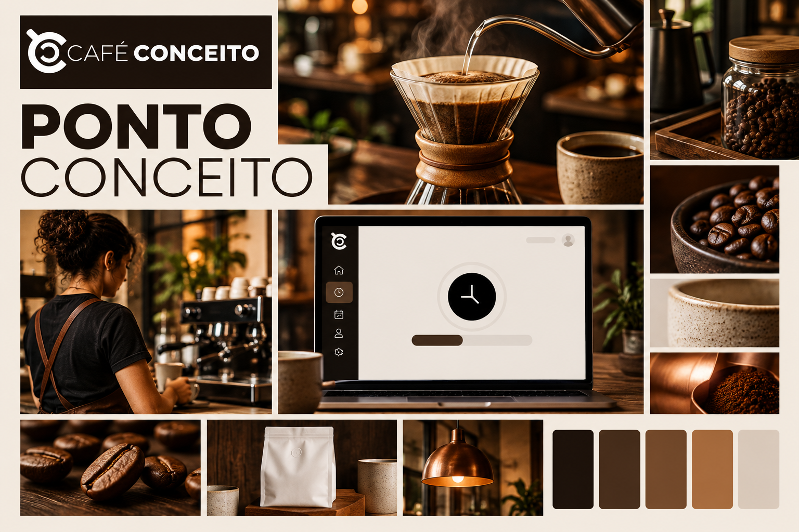

# Design system — Ponto Conceito

Este documento reúne a identidade visual e as regras de interface do sistema de ponto da Café Conceito. Ele orienta a landing page, o login e as áreas de funcionário e administração.

## Direção visual

**Ideia central:** uma rotina de trabalho clara, apresentada com o mesmo cuidado e acolhimento que a Café Conceito dedica à experiência do café.

**Personalidade:** acolhedora, organizada, confiável e direta. O produto deve parecer parte da empresa, sem transformar uma ferramenta de trabalho em uma peça publicitária.

**Referências usadas:** o logotipo preto e branco fornecido para o projeto e a comunicação pública da [Café Conceito](https://cafeconceito.com.br/), que destaca cafés especiais, experiência, conexão e ambientes acolhedores. A paleta abaixo é uma extensão digital proposta para o sistema; não substitui um manual oficial da marca.

## Nome e assinatura

- Nome do produto: **Ponto Conceito**.
- Empresa: **Café Conceito**.
- Forma de apresentação preferida: “Ponto Conceito, um sistema do Café Conceito”.
- Em títulos curtos e navegação, use “Ponto Conceito”. Em textos explicativos, pode usar “sistema de ponto do Café Conceito”.
- Não use a antiga marca textual “ponto.”.

### Logotipo

- Use o arquivo original `public/img/cafe-conceito-logo.png` sem redesenhar, deformar, recortar, inclinar ou trocar as cores.
- Mantenha o logotipo branco sobre uma base escura uniforme, como no cabeçalho atual. Preserve sua proporção e área de respiro.
- Para a marca do produto, escreva “Ponto Conceito” ao lado do logo; não altere o logo da Café Conceito para inserir o nome do sistema.
- O texto alternativo do logo deve identificar “Café Conceito”. Se o nome da empresa já estiver imediatamente repetido no mesmo bloco acessível, o logo pode ter texto alternativo vazio para evitar leitura duplicada.
- Não use versões geradas por IA do logo. O moodboard é referência de atmosfera, não um arquivo de marca; letras e marcas ilustrativas que apareçam na prancha não são a assinatura oficial.

## Cores

Os valores abaixo são os tokens da interface. A base quente vem do café, da madeira e do papel; o cobre é o acento. Verde não é cor de marca neste sistema e deve aparecer somente quando tiver significado de sucesso.

| Token | Valor | Uso |
| --- | --- | --- |
| `--ink` | `#2B211B` | Texto principal e elementos de alto contraste. |
| `--coffee` | `#21160F` | Fundo de cartões escuros e ações escuras. |
| `--accent` | `#8A5736` | Botão principal, links destacados e foco. |
| `--accent-soft` | `#F1E5DA` | Fundo de ícones, realces suaves e estados selecionados. |
| `--paper` | `#F6F1EB` | Fundo geral das páginas. |
| `--surface` | `#FFFDFA` | Cartões, formulários, tabelas e campos. |
| `--line` | `#E8DED3` | Bordas e divisores. |
| `--muted` | `#786B60` | Texto auxiliar, instruções e metadados. |
| `--copper` | `#B8794F` | Detalhes decorativos pequenos; não usar em texto miúdo sobre branco. |
| `--success` | `#416B49` | Confirmação de marcação concluída e conta ativa. |
| `--warning` | `#8A643D` | Jornada em andamento ou atenção necessária. |
| `--danger` | `#9B4736` | Erros de formulário ou ação recusada. |

### Regras de contraste

- Use `--ink` sobre `--paper` e `--surface` para textos corridos.
- Use `--accent` com texto branco nos botões principais. Use `--copper` como detalhe, não como texto pequeno sobre fundo claro.
- Não comunique situação só pela cor: mantenha também rótulos como “Concluída”, “Em andamento” e “Aguardando”.
- Mantenha indicador de foco visível no teclado e não remova o contorno sem substituí-lo por outro de contraste claro.

## Tipografia

- **Interface e texto corrido:** pilha nativa `system-ui`, com fallback para `Segoe UI`, `Arial` e sans-serif. Isso mantém o sistema legível sem depender de fontes externas.
- **Títulos e números de destaque:** Georgia ou serifas de sistema equivalentes, em pesos moderados. Use o contraste editorial com moderação para preservar a leitura rápida.
- **Horários:** números alinhados e fáceis de comparar; use dígitos tabulares quando possível.
- **Hierarquia:** título principal de 36–56 px no desktop e 30–42 px no celular; título de cartão de 16–22 px; texto de leitura de pelo menos 14 px; metadados podem ser menores, desde que não contenham instruções essenciais.
- Evite caixa alta em frases completas. Use-a apenas em rótulos curtos, com espaçamento discreto entre letras.

## Forma e composição

- Use uma base de espaçamento de 4 px; priorize intervalos de 8, 12, 16, 24 e 32 px.
- Use raios de 10–12 px em campos e botões, 14–18 px em cartões e até 24 px em blocos grandes da landing.
- Prefira fundos claros, bordas finas e sombras suaves. Reserve superfícies espresso para áreas de destaque, como o cartão ilustrativo da jornada.
- Organize o conteúdo em um eixo central, com largura máxima próxima a 1160 px.
- Evite contornos pesados, degradês chamativos, brilho neon, excesso de cartões e elementos decorativos que concorram com horários ou ações.

## Componentes

### Navegação e marca

- O cabeçalho tem logo Café Conceito, assinatura “Ponto Conceito” e somente os links pertinentes à tela.
- “Entrar no sistema” leva ao `/login`. Dentro da área autenticada, mostre a área atual, o usuário quando couber e a ação “Sair”.
- Em celular, reduza a marca mantendo ambos os nomes legíveis e esconda links secundários antes de apertar os controles.

### Botões

- Ação principal: fundo `--accent`, texto branco, rótulo com verbo claro; exemplo: “Registrar entrada”.
- Ação administrativa ou secundária: fundo `--coffee` ou botão contornado, conforme a importância.
- Não use setas ou ícones como único rótulo de uma ação.
- Estados de hover e foco devem ser perceptíveis; o botão não deve depender de animação para comunicar que pode ser acionado.

### Campos e mensagens

- Campos devem ter rótulo visível fora do placeholder, altura confortável e foco destacado.
- Erros ficam próximos ao campo ou formulário a que pertencem, em linguagem simples e sem expor dados sensíveis.
- Mensagens de sucesso usam texto explícito e tom verde semântico. Não sinalize sucesso apenas com um ícone.

### Jornada e estados

- Apresente sempre a sequência **Entrada → Intervalo → Retorno → Saída**.
- Destaque uma única próxima ação. Horários já registrados aparecem como concluídos; etapas futuras, como aguardando.
- O usuário deve entender qual horário foi salvo e o que pode fazer em seguida.
- Histórico usa cabeçalho de tabela claro, datas e horas alinhadas e estado escrito por extenso. Em telas estreitas, permita rolagem horizontal da tabela sem encolher o conteúdo até ficar ilegível.

### Administração

- Priorize números de acompanhamento, filtros e tabelas da equipe. A lista de funcionários deve mostrar dez pessoas por página e uma ação clara para abrir o histórico individual.
- O espelho mensal deve apresentar as quatro marcações por data, opções separadas para CSV e impressão/salvamento em PDF, e linhas de assinatura sem esconder registros incompletos.
- Na versão impressa, use papel A4 horizontal, repita o cabeçalho da tabela quando houver quebra de página e mantenha cada bloco de assinatura junto ao nome correspondente.
- Indique que dias sem registro não significam automaticamente ausência ou folga; não apresente cálculo de jornada enquanto essa regra não estiver definida.
- A configuração de IP deve explicar que se informa o IP público fixo de saída da empresa e que a regra limita as marcações, não o login nem a consulta do histórico.
- Mantenha filtros identificados e preserve os valores escolhidos depois da consulta.

## Direção por tela

### `/` — Landing page

- Apresenta “Ponto Conceito” como sistema da equipe Café Conceito, com linguagem acolhedora e objetiva.
- O primeiro bloco explica o benefício e apresenta um botão evidente para `/login`.
- Mostra visualmente a jornada de quatro etapas; não sugere reconhecimento facial, geolocalização ou recursos fora do escopo.
- As seções seguintes explicam o fluxo e o acompanhamento de equipe, sem promessas comerciais não aprovadas.

### `/login` — Acesso

- Mantém a assinatura do produto e deixa claro que funcionário e administrador usam o mesmo login.
- Explica que o acesso usa CPF e senha; não sugere cadastro público nem recuperação de senha, pois esses fluxos não existem nesta versão.
- O formulário deve ser o elemento de maior destaque da coluna de acesso.
- A apresentação pode usar um painel espresso com a explicação dos perfis ao lado do formulário claro, mantendo a leitura confortável em celular.

### `/cadastro` — Cadastro de funcionários

- Identifica a área administrativa e deixa visíveis campos obrigatórios e opcionais.
- Agrupa dados pessoais e credenciais sem transformar o formulário em uma página promocional.
- Organiza o formulário visualmente em “Identificação” e “Acesso ao sistema”, sem alterar os campos exigidos pelo cadastro.
- Confirmações e erros devem permitir corrigir o cadastro sem adivinhar qual campo falhou.

### `/dashboard` — Jornada do funcionário

- Dá prioridade ao estado do dia, à próxima marcação e ao botão correspondente.
- O histórico mensal fica disponível abaixo da jornada, com filtro de mês e estados legíveis.
- Mostra somente os registros da conta autenticada, de acordo com as regras do produto.
- O cabeçalho de boas-vindas usa contraste alto e a data fica visível como contexto da jornada atual.
- A etapa liberada e seu botão ficam fáceis de localizar; cartões de resumo e histórico usam a mesma escala tipográfica e os mesmos estados semânticos.

### `/admin` — Acompanhamento

- Mostra um resumo da equipe, filtros de mês/funcionário e a tabela de jornadas.
- Mantém o cadastro de funcionários e a restrição por IP em seções identificadas.
- Não destaca dados pessoais além do necessário para identificar a pessoa e acompanhar a jornada.
- Os indicadores aparecem antes da tabela; filtros, controle do IP e lista da equipe formam blocos separados e identificados.

## Imagens e ícones

- A identidade é construída primeiro com tipografia, cor e espaçamento; fotografia não é necessária nos painéis de uso diário.
- Se forem usadas imagens futuras, prefira café brasileiro, madeira, cerâmica e espaços acolhedores, com luz natural quente e pessoas em situação de trabalho realista.
- Não usar bancos de imagem frios, relógios de ponto antigos, clichês de escritório corporativo ou cafés genéricos com marca inventada.
- Ícones devem ser simples, consistentes e acompanhados por rótulo quando representam uma ação.

## Responsividade e acessibilidade

- A interface deve funcionar a partir de 320 px de largura, sem rolagem horizontal da página.
- Os pontos atuais de adaptação são 900 px, 680 px e 390 px; ajuste-os se o conteúdo real pedir, mantendo a prioridade de toque e leitura.
- Preserve ordem de foco igual à ordem visual, rótulos associados aos campos, texto alternativo útil e regiões de status acessíveis.
- Controles devem ter área de toque confortável; não dependa de hover para revelar ações.
- Respeite `prefers-reduced-motion` para qualquer animação acrescentada.

## Implementação e manutenção

- Layout compartilhado: `resources/views/pontoeletronico/layout.blade.php`.
- Landing: `resources/views/pontoeletronico/index.blade.php`.
- Login, cadastro, painel do funcionário e administração: as views homônimas em `resources/views/pontoeletronico/`.
- Tokens e componentes: `public/css/ponto.css`.
- Logo original: `public/img/cafe-conceito-logo.png`.
- Moodboard: `docs/identidade/moodboard-ponto-conceito.png`.
- Ao adicionar uma tela ou alterar a aparência de um componente compartilhado, atualize esta documentação e preserve o fluxo funcional descrito em `PRD.md`.
