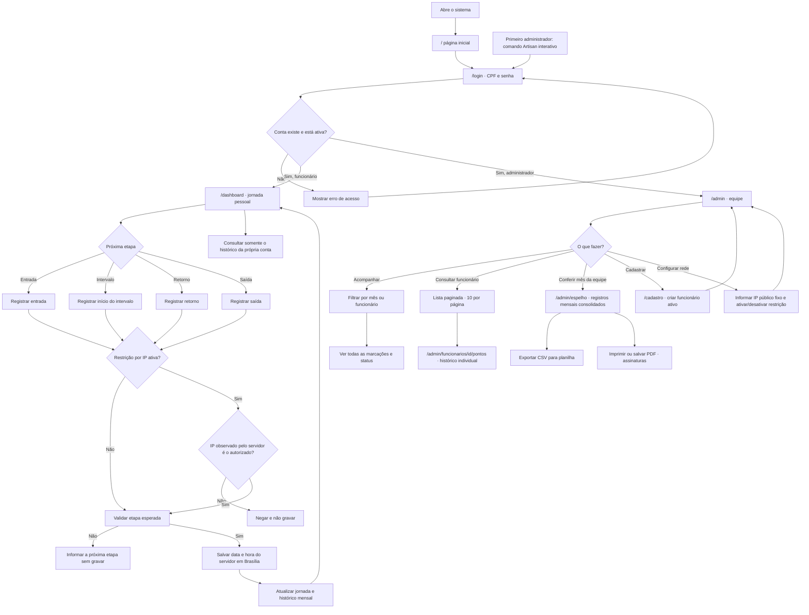

# Fluxograma do Ponto Conceito

As cinco telas principais formam dois caminhos: o funcionário registra e consulta a própria jornada; o administrador acompanha a equipe, cria funcionários e configura a rede autorizada.

## Observações

- Login é compartilhado; o papel armazenado na conta decide para qual painel o usuário é enviado.
- A autorização administrativa é checada no servidor. Uma conta de funcionário não pode abrir diretamente `/cadastro` ou `/admin`.
- A restrição por IP afeta cada gravação de ponto. Login e consulta do histórico continuam acessíveis de outra rede.
- O IP é o endereço público da rede da empresa, não o IP local do roteador.
- O sistema não confia em cabeçalhos de IP encaminhados por padrão. Hospedagem com proxy reverso exige configuração explícita de proxies confiáveis.
- A jornada é agrupada pela data local e não cobre corretamente uma jornada que atravesse a meia-noite.
- O espelho mensal apresenta as marcações armazenadas; datas sem registro não são automaticamente classificadas como falta ou folga e as horas trabalhadas não são calculadas.
- O espelho pode ser exportado em CSV ou impresso/salvo em PDF para conferência e assinatura.
