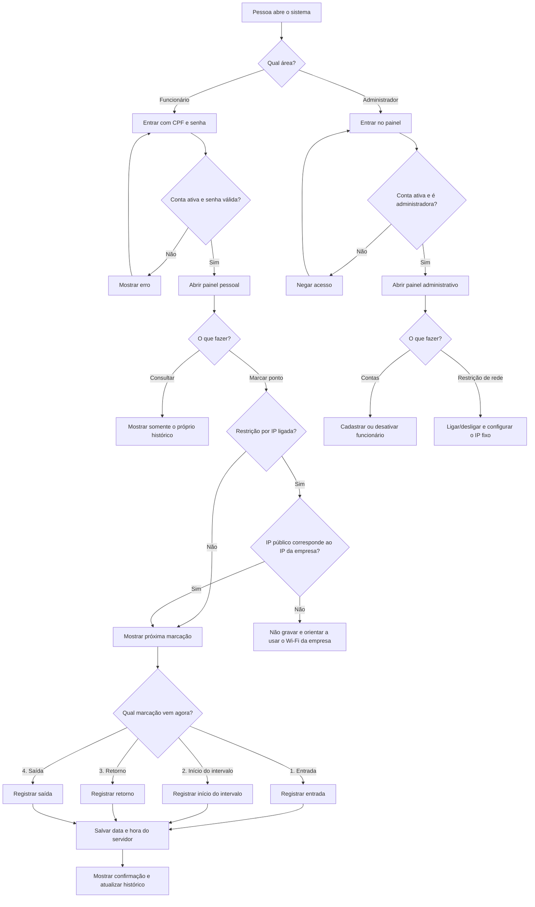

# Fluxograma do MVP

O MVP tem dois caminhos: o funcionário marca os quatro horários e consulta os próprios registros; o administrador mantém as contas e a opção de IP.

## Regras que o desenho representa

- A sequência é: entrada → início do intervalo → retorno → saída.
- Se a restrição estiver ligada, cada uma das quatro marcações exige que o IP de origem corresponda ao IP público autorizado.
- Login e consulta de histórico não dependem do IP autorizado.
- O funcionário precisa continuar entrando com sua própria conta. O IP identifica a rede, não a pessoa.
- O protótipo atual só tem campos para entrada e saída; início e retorno ainda precisam ser acrescentados.
- Justificativas, anexos, aprovações e relatórios existentes no protótipo ficam desativados no MVP.

O IP validado é o endereço público de saída do Wi-Fi, não o nome da rede nem o IP privado do roteador. Se a hospedagem usa proxy, ele precisa estar configurado corretamente para o sistema receber o endereço real do visitante.
