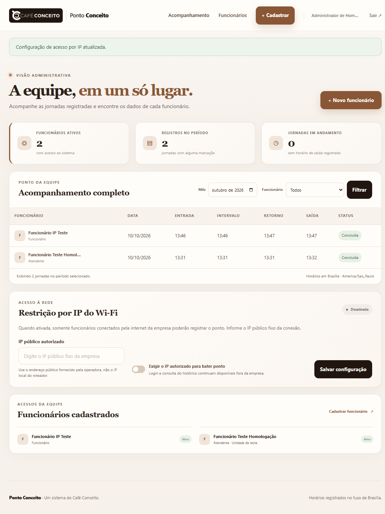

# Homologação local em Docker — Ponto Conceito

**Data:** 10/10/2026
**Resultado:** fluxos principais aprovados em homologação local; a liberação para uso real ainda depende das validações de rede descritas abaixo.

## Ambiente e proteção dos dados

- A aplicação foi testada no navegador como funcionário e administrador.
- A homologação usou o Compose isolado `ponto-conceito-homologacao`, na porta `8002`, com MariaDB e volume próprios e contas fictícias.
- A instância local preexistente na porta `8001` e seu banco não foram usados nem alterados. Ao terminar, a instância temporária e o banco de teste foram removidos; a instância original permaneceu ativa.
- As capturas abaixo contêm somente nomes e registros fictícios. Este documento não contém senhas, CPFs ou o endereço IP usado no teste.

## Cenários percorridos

| Cenário | Resultado |
|---|---|
| Abrir a landing page e acessar a tela de login | Aprovado |
| Entrar como administrador e abrir o acompanhamento da equipe | Aprovado |
| Cadastrar funcionário pela interface administrativa | Aprovado |
| Tentar cadastrar CPF duplicado | Bloqueado com validação de campo, como esperado |
| Tentar login de funcionário com senha errada | Bloqueado com mensagem de credenciais inválidas |
| Entrar como funcionário e ver a própria jornada | Aprovado |
| Registrar entrada, início do intervalo, retorno e saída na ordem | Aprovado para duas contas fictícias |
| Ver o histórico do mês atual e consultar mês sem registros | Aprovado |
| Filtrar o acompanhamento administrativo por funcionário | Aprovado |
| Acessar `/admin` e `/cadastro` como funcionário | Negado; o usuário voltou ao painel pessoal |
| Abrir páginas protegidas sem sessão e após sair | Redirecionado ao login |
| Tentar configurar um IP privado no painel | Rejeitado com orientação para usar IP público |
| Ativar a restrição com um IP público fictício | Configuração aceita no banco isolado |
| Tentar bater ponto com a restrição ativa fora do IP configurado | Batida negada; login e consulta ao painel continuaram disponíveis e nenhum registro foi criado |
| Desativar a restrição e concluir nova jornada | Aprovado |

As mensagens das quatro marcações foram conferidas: “Entrada registrada.”, “Intervalo iniciado.”, “Retorno do intervalo registrado.” e “Saída registrada.”.

## Capturas da homologação

## Correções feitas durante o teste

1. Um dia sem batidas aparecia como “Em andamento”. A tela agora informa “Ainda não iniciada” até que a entrada exista.
2. As mensagens de intervalo e retorno tinham concordância incorreta. O controlador agora mostra mensagens específicas para cada uma das quatro marcações.

As duas situações foram repetidas no navegador depois das correções.

## Suíte automatizada existente

Comando executado dentro do container web isolado: `vendor/bin/phpunit`.

**Resultado:** 2 testes e 2 asserções passaram. Essa suíte ainda é pequena e não cobre as regras centrais de cadastro, sequência de marcações, permissões ou restrição por IP; a aprovação desses fluxos acima veio da navegação manual no navegador.

## O que ainda falta validar antes do uso real

- Confirmar com a operadora o IP público fixo real do Café Conceito.
- Repetir a batida permitida conectado ao Wi-Fi da empresa e a batida bloqueada usando uma rede externa. O navegador desta homologação estava na máquina local; por isso não comprova o caminho permitido pelo IP público real.
- Se a hospedagem usar proxy reverso, configurar e validar os proxies confiáveis para que o Laravel identifique o IP público correto.
- Definir como a administração corrigirá batidas esquecidas ou repetidas e como tratar jornadas que cruzem a meia-noite.
- Definir recuperação de senha, desligamento de contas e rotina de backup e restauração.
- Homologar as regras operacionais com os responsáveis da empresa.

Este teste não incluiu carga, teste de segurança independente nem implantação em servidor público. Portanto, “aprovado” significa que os cenários funcionais acima passaram no ambiente local descartável; não significa que a operação real já esteja liberada.
